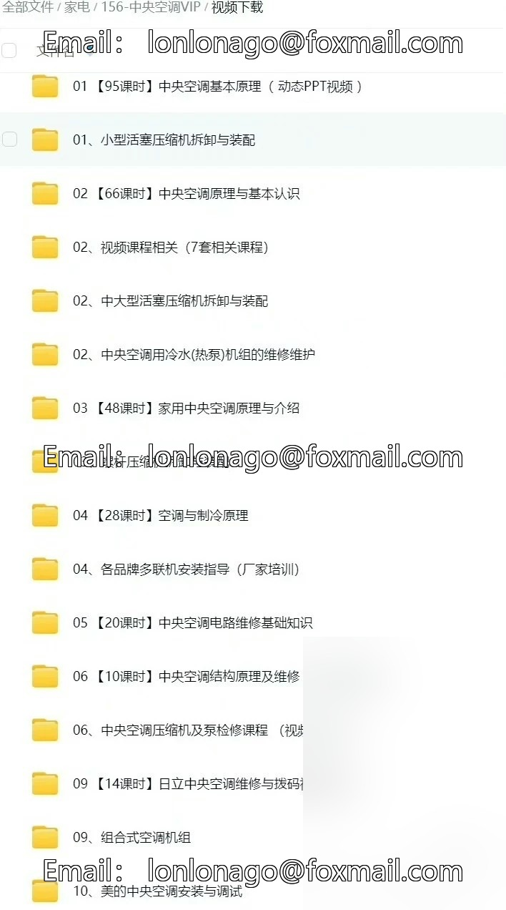
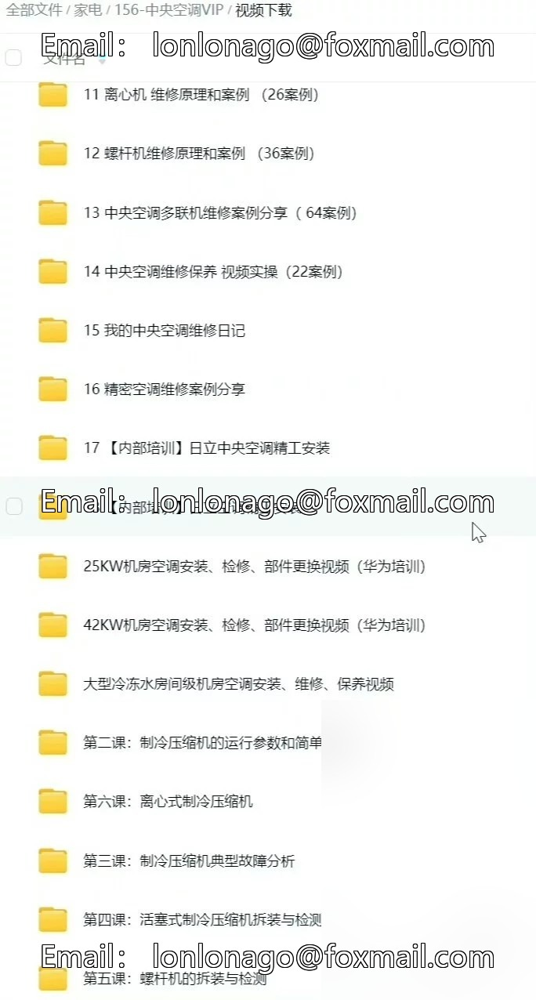
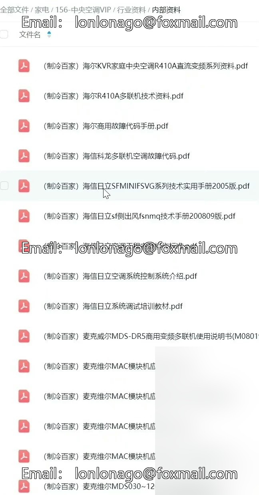
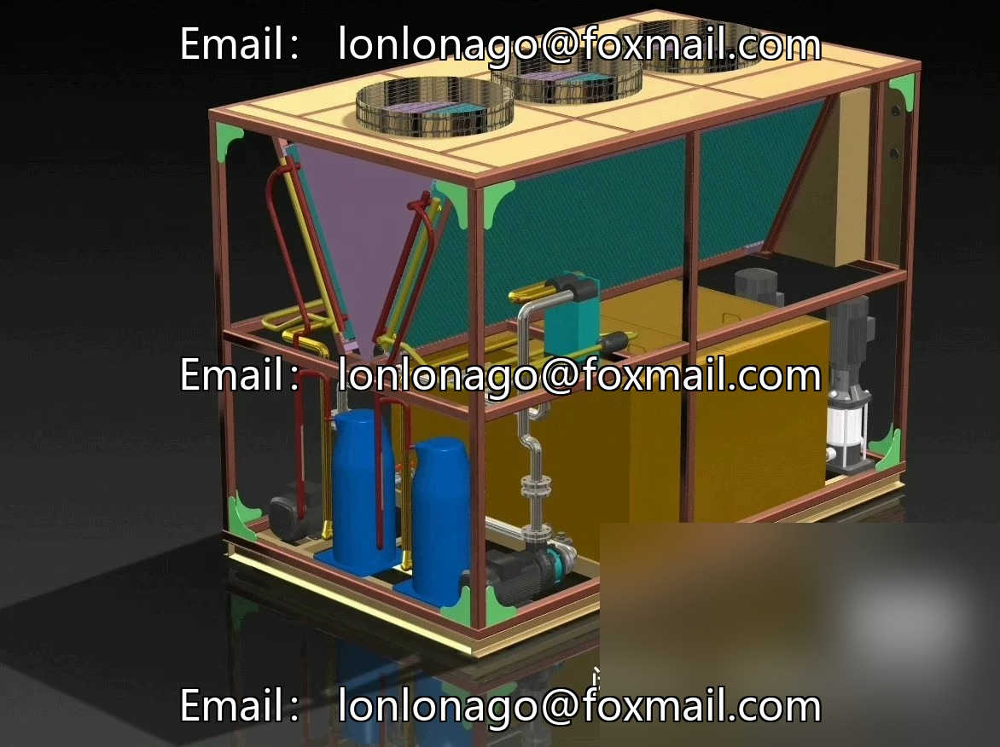
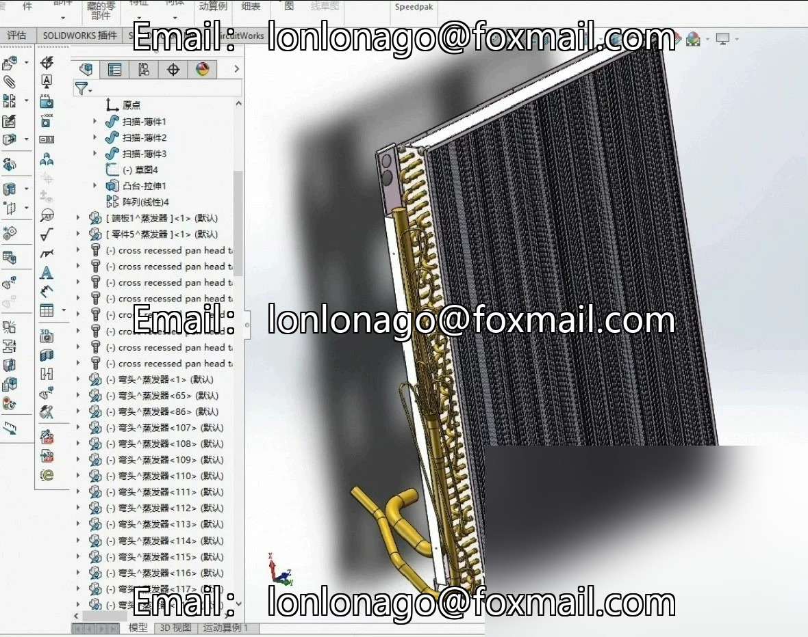
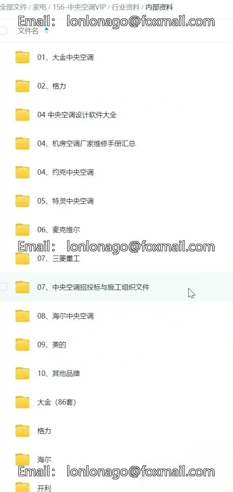

# Collection of nearly a hundred sets of 3D models for air conditioning units and refrigeration equipment.

## Body

Collection of nearly a hundred sets of 3D models for air conditioning units and refrigeration equipment
This resource includes SolidWorks 3D models for various core components such as compressors, condensers, evaporators, etc., covering a variety of air conditioning unit types. The models are editable upon opening and support secondary modifications, making them highly suitable for university course design projects, engineers' systematic drawings, and project references.

New] Purchase and get a gift
Collection of video tutorials on central air conditioning installation and maintenance (35 complete courses) and associated materials. The content covers multi-brand multi-unit air conditioner maintenance and electrical principles, from basic to mastery, including a large number of practical cases, helping you quickly improve professional skills.

[Price] The listed price is the selling price.
⚠️ Please be cautious when placing orders after sale.
[Materials] This information is for personal study only and is prohibited from commercial use.

Start your journey of design and technology enhancement immediately.

## Images

## Payment

Here is a pay link on Stripe ( https://buy.stripe.com/3cs8yP7sY87d0vu9AB ). Please contact me lonlonago@foxmail.com after funding $89, and I will send you a complete data files , thank you!

